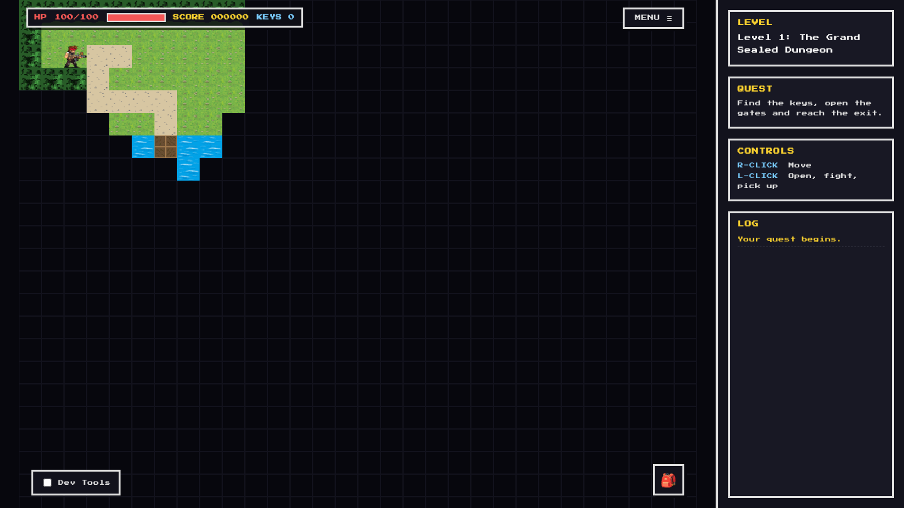
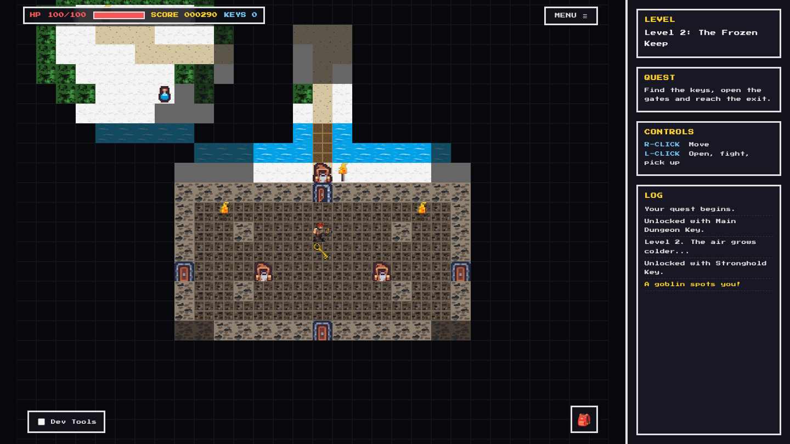
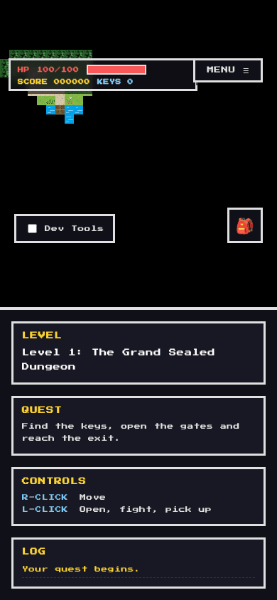

# Web-Based 2D Game Engine Framework

A modular TypeScript engine for 2D square-grid games in the browser, rendered with PixiJS, plus a playable dungeon demo built on top of it.

The engine handles rendering, multi-layer JSON maps, camera and view fitting, A* pathfinding with terrain costs, field of view with shadows and multiple lights, Fog of War, flood-fill room reveal, and mouse-to-cell input. Game rules such as health, combat, keys and levels live in the demo, not the engine.



## Contents

- [Branches and the npm package](#branches-and-the-npm-package)
- [Screenshots](#screenshots)
- [Features](#features)
- [Thesis requirements](#thesis-requirements)
- [Getting started](#getting-started)
- [Repository layout](#repository-layout)
- [Using the engine in your own game](#using-the-engine-in-your-own-game)
- [Map format](#map-format)
- [The demo game](#the-demo-game)
- [Architecture](#architecture)
- [Tests](#tests)
- [Performance](#performance)
- [What changed from the previous version](#what-changed-from-the-previous-version)
- [Roadmap](#roadmap)

## Branches and the npm package

| Where | What it holds | Use it to |
|---|---|---|
| `main` | The whole project: the engine package, the demo game, tests and docs | Run the demo or read the full project |
| `develop` | The same as `main`, where new work lands first | Contribute |
| `engineFramework` | Only the engine, at the top of the repository, with no demo | Start working on the engine itself |
| GitHub Packages: `@doz6x9/web-based-2d-game-engine-framework` | The built engine (ESM, CommonJS and TypeScript types) | Build your own game with `npm install` |

The demo imports the engine by its package name, exactly like any other project would, so it always runs on what gets published.

## Screenshots

| | |
|---|---|
|  |  |
| **A\* and mouse input.** Right-clicking a cell shows the planned path as dots. Each click is labelled with its grid cell: green for left, orange for right. | **Flood fill room reveal.** Opening the gate reveals the whole hall behind it, with its walls, but nothing past the next doors. Explored cells out of sight are greyed out. |
|  |  |
| **Several lights at once.** Torches light their own areas and cast shadows from walls. Torches in rooms you have not found yet stay dark. | **Phone layout.** The map scales to fit and the side panel moves below it. |

## Features

### Engine (`packages/engine`)

- **Rendering with PixiJS 8.** Layers draw bottom-up (ground, landmarks and other overlay layers, objects, entities, fog, effects). Tiles and sprites can come from single images or one texture atlas.
- **Multi-layer JSON maps.** Each layer has a role. The ground layer sets tile types, an optional collision layer overrides walkability, and any other layers (such as `landmarks`: flowers, rocks, bones, banners) are drawn on top in file order without affecting movement. Layer names are read from the map or passed to the engine, with `terrain` and `collision` as defaults. An `objects` list places spawns, items, doors and lights.
- **View handling.** The camera keeps a chosen cell (usually the player) centred on large maps, horizontally and vertically, and stops at the map edges. Level 2 is 48×30 cells, wider than the 40-cell canvas, so it scrolls sideways as you walk. Small maps get the largest whole-number zoom that fits, so pixels stay sharp, and are centred. The canvas can shrink to the map so there are no empty borders.
- **A\* pathfinding with terrain costs.** Road costs 0.5, grass 1, sand and snow 1.5, cave floor 1.2 and swamp 3. Walls, water and forest block movement. The heuristic is scaled by the cheapest tile, so the path found is always the cheapest one. Costs and walkability come from one place, `TileRegistry`, so the grid, renderer and pathfinder always agree.
- **Field of view and shadows.** Raycasting or recursive symmetric shadowcasting over all eight octants, from each light. Walls stop the view and cast shadows behind them, and light can't slip through the corner where two walls touch diagonally.
- **Several light sources.** The lighting system merges any number of lights into one visible set. It only recalculates when a light moves, changes or is toggled. Lights can stay dark until their cell has been explored.
- **Fog of War.** Unexplored cells are fully black (an optional faint grid is available). Explored cells out of view are greyed out, and visible cells are drawn normally.
- **Room visibility with flood fill.** `engine.revealRoom(cell)` fills from a cell until it hits walls, then marks the room and its walls as explored. This is used when a door opens.
- **Mouse input.** Left and right clicks are turned into grid cells, taking CSS scaling, zoom and centring into account. The clicked cell's coordinates can be drawn on the canvas.
- **Also included.** Particles, sprite animation and tweens, a typed event system, a level editor helper, and spawn-point lookup.

### Demo (`apps/demo`)

- Two hand-made levels: **The Grand Sealed Dungeon** and **The Frozen Keep**.
- Keys, locked gates, chests, health potions, goblins with turn-based combat, a boss, a score and a game-over screen.
- A retro pixel style with a side panel for the level, quest, controls and message log.
- Dev Tools showing FPS, the player's cell and the mouse cell.

## Thesis requirements

How each requirement of the thesis topic is met, and where to find it.

| Requirement | Where it is met |
|---|---|
| HTML5, SCSS, TypeScript and PixiJS | `apps/demo/index.html`, `apps/demo/src/styles/main.scss`, all source in TypeScript, rendering in `packages/engine/src/render/Renderer.ts` |
| Rendering module that draws map layers bottom-up | `Renderer.renderMap` with ordered layer containers in `Renderer.ts`; the demo maps have ground, landmarks and entities |
| Maps defined in multi-layer JSON and loaded from a file | `MapLoader` in `packages/engine/src/map/MapLayer.ts`; maps in `apps/demo/public/maps/` |
| View handling: show part of a large map, centred on a cell | `Camera.centerOn`, `Camera.fitZoomToMap` and `GameEngine.fitViewToMap`; level 2 is wider and taller than the canvas, so it scrolls both ways |
| A\* that weighs terrain costs as well as walls | `packages/engine/src/algorithms/AStar.ts` and tile costs in `core/TileRegistry.ts`; tested against Dijkstra |
| Real-time field of view and shadows from walls | `packages/engine/src/algorithms/FieldOfView.ts` |
| Multiple light sources such as torches | `packages/engine/src/systems/LightingSystem.ts`; torches in both demo maps |
| Fog of War: explored areas greyed out, unexplored fully dark | `packages/engine/src/algorithms/FogOfWar.ts` and the fog layer in `Renderer.ts` |
| Flood-fill room visibility when a door opens | `FloodFill.ts` and `GameEngine.revealRoom`; called by the demo's door logic |
| Turn left and right clicks into grid cells and print them on the canvas | `packages/engine/src/interaction/MouseHandler.ts`, `Camera.screenToWorld`, `Renderer.showClickCoordinates` |
| Demo where clicks update the field of view and Fog of War | `apps/demo`: right-click to move, lights and fog update as you go |
| Git and GitHub for version control | This repository |

## Getting started

You need Node.js 20.19 or newer and npm.

```bash
git clone https://github.com/doz6x9/web-based-2d-game-engine-framework.git
cd web-based-2d-game-engine-framework
npm install
npm run dev        # builds the engine, then starts the demo at http://localhost:5173
```

Other scripts, run from the repository root:

| Command | What it does |
|---|---|
| `npm run build` | Builds the engine, then the demo (`apps/demo/dist`) |
| `npm run build:engine` | Builds only the engine package (`packages/engine/dist`) |
| `npm test` | Runs the engine's unit tests |
| `npm run typecheck` | Type-checks every workspace |

## Repository layout

```
.
├── packages/
│   └── engine/                 # the npm package
│       ├── src/
│       │   ├── GameEngine.ts   # ties the systems together, events, map loading
│       │   ├── algorithms/     # AStar, FieldOfView, FogOfWar, FloodFill
│       │   ├── core/           # Grid, Vector, TileRegistry, MapObject
│       │   ├── map/            # MapLayer and MapLoader (JSON maps)
│       │   ├── render/         # Renderer and Camera, Animation, Particles
│       │   ├── systems/        # LightingSystem
│       │   ├── interaction/    # MouseHandler, KeyboardHandler
│       │   └── editor/         # LevelEditor
│       ├── test/               # Vitest unit tests
│       └── README.md           # full engine API guide
├── apps/
│   └── demo/                   # the dungeon game
│       ├── src/game/           # GameApp (game rules), Hud, canvas fitting
│       ├── src/styles/         # SCSS
│       ├── public/maps/        # level JSON files
│       ├── art/                # source sprites, packed into one atlas at build time
│       └── scripts/            # atlas packer
├── docs/screenshots/
└── vercel.json                 # deploys the demo
```

## Using the engine in your own game

GitHub Packages needs two lines in an `.npmrc` file in your project, even for public packages. The token is a GitHub personal access token (classic) with the `read:packages` scope.

```ini
@doz6x9:registry=https://npm.pkg.github.com
//npm.pkg.github.com/:_authToken=YOUR_GITHUB_TOKEN
```

Then install it with PixiJS:

```bash
npm install @doz6x9/web-based-2d-game-engine-framework@^0.3.0 pixi.js
```

```ts
import { GameEngine, Vector } from '@doz6x9/web-based-2d-game-engine-framework';

const engine = new GameEngine();
await engine.initWithOptions({
  canvas: document.querySelector<HTMLCanvasElement>('#game')!,
  width: 1280,
  height: 720,
  assets: [{ id: 'atlas', path: '/atlas/sprites.json', type: 'spritesheet' }],
  initialMapUrl: '/maps/level-1.json',
  showMouseCoordinates: true,
});

const player = new Vector(2, 2);
engine.lighting.addLight({ id: 'player', position: player, radius: 8 });

engine.on('gridClick', (x, y, button) => {
  if (button === 'right') {
    const path = engine.pathfinder.findPath(player, new Vector(x, y));
    console.log('path', path);
  }
});
```

The full API, with every option and event, is in the [engine README](packages/engine/README.md).

## Map format

```json
{
  "name": "Level 1",
  "width": 30,
  "height": 30,
  "layers": [
    { "name": "terrain",   "data": [[11, 11, 11], [11, 4, 0]] },
    { "name": "landmarks", "data": [[0, 0, 0], [0, 0, 20]] },
    { "name": "collision", "data": [[1, 1, 1], [1, 0, 0]] }
  ],
  "objects": [
    { "type": "PLAYER_SPAWN", "x": 1, "y": 1 },
    { "type": "LIGHT_SOURCE", "id": "torch_1", "x": 2, "y": 1, "radius": 4, "sprite": "torch" },
    { "type": "DOOR", "id": "gate", "x": 5, "y": 3, "keyId": "gate_key", "sprite": "gate" }
  ]
}
```

| Id | Tile | Walkable | Move cost |
|---|---|---|---|
| 0 | Grass | Yes | 1 |
| 1 | Cave wall | No | |
| 2 | Water | No | |
| 3 | Sand | Yes | 1.5 |
| 4 | Path / road | Yes | 0.5 |
| 5 | Stone floor | Yes | 1 |
| 6 | Deep water | No | |
| 7 | Snow | Yes | 1.5 |
| 8 | Cave floor | Yes | 1.2 |
| 9 | Wood floor | Yes | 1 |
| 10 | Swamp | Yes | 3 |
| 11 | Forest | No | |

## The demo game

| Input | Action |
|---|---|
| Right-click | Walk to a cell along the cheapest path |
| Left-click | Open a door or chest, attack a goblin, pick up an item |
| Menu | Pause (Save, Load, Mute and Skip are placeholders for later systems) |
| Bag | Show the inventory and drink potions |
| Dev Tools | Show FPS, the player's cell and the mouse cell |

Find the keys, open the gates in order, beat the boss and reach the exit. Each door you open reveals the room behind it, and torches inside only light up once you find them.

## Architecture

The engine knows nothing about health, keys or goblins. It provides systems and events, and the game decides what they mean.

```
┌──────────────────────────────────────────────────────┐
│  apps/demo: GameApp                                  │
│  turns, combat, keys and doors, items, levels, HUD   │
└──────────────┬───────────────────────────────────────┘
               │ engine.on('gridClick' | 'update' | 'mapLoaded' ...)
               ▼
┌──────────────────────────────────────────────────────┐
│  packages/engine: GameEngine                         │
│  map loading, entities, events, view fitting         │
├──────────────────────────────────────────────────────┤
│  Grid · AStar · FieldOfView · LightingSystem         │
│  FogOfWar · FloodFill · Renderer/Camera · Input      │
└──────────────────────────────────────────────────────┘
```

Each frame, the lighting system merges the field of view from every light and passes it to Fog of War. The renderer then draws the map, entities and fog. The fog layer is only redrawn when the fog actually changes.

## Tests

```bash
npm test
```

There are 61 unit tests (Vitest) in `packages/engine/test`:

- **A\*:** straight paths, walls, unreachable goals, taking a cheap road around a swamp, crossing the swamp when that is cheaper, and matching Dijkstra's cost on mixed terrain.
- **Field of view:** radius limits, walls blocking sight, closed rooms, and both raycasting and shadowcasting.
- **Shadowcasting:** a full disc on open ground, all eight octants, shadows behind a wall, doorways, symmetry (if A sees B, B sees A), and no light through diagonal wall gaps for either algorithm.
- **Map layers:** default, map-defined and engine-supplied layer names, explicit roles, a map with no collision layer, and overlay layers not blocking movement.
- **Tile costs:** every grid cell takes its cost and walkability from `TileRegistry`, including tiles a game registers.
- **Lighting:** the union of several lights, lights kept inside their rooms, skipping work when nothing changed, toggling lights, and torches hidden until explored.
- **Fog of War:** state changes, explored memory, and reset.
- **Flood fill:** filling a room, spreading through an open door, the size limit, and `revealRoom` revealing only the room behind a door.
- **Mouse to cell:** CSS scaling, zoom, centring and scrolling.

## Performance

- All sprites are packed into one texture atlas at build time, so the demo makes one image request and PixiJS can batch drawing.
- Over a throttled connection (4 Mbps, 150 ms latency), the time until the player appears went from about 7 s to about 1.7 s.
- Per-frame JavaScript time dropped from about 2.1 ms to about 0.7 ms. Lighting and fog only recalculate when something changes.
- The frame rate is not capped at 60, and Dev Tools shows the real FPS.

## What changed from the previous version

| Before | Now |
|---|---|
| One app with the engine in `src/engine` | An npm workspaces monorepo: `packages/engine` (published) and `apps/demo` (imports it by name) |
| Engine code and game code mixed on some branches | The engine has no game rules; combat, keys and levels live in `apps/demo/src/game/GameApp.ts` |
| Single light at a time | `LightingSystem` merges any number of lights, with torches that stay dark until found |
| Unexplored fog was not fully dark | Unexplored cells are fully black; explored cells are greyed out |
| Flood fill existed but was not used | Opening a door reveals the room behind it |
| A\* could return a path that was not the cheapest | The heuristic is scaled to the cheapest tile; checked against Dijkstra in tests |
| Clicked cells were not shown on the canvas | Left and right clicks are labelled on the canvas in different colours |
| Fixed canvas with empty space around small maps | Whole-number zoom, centring, and a canvas that fits the map |
| The tile table listed ids that did not match the code | The tile table above matches `TileRegistry.ts`, the single source of tile costs |
| Maps had only terrain and collision | A `landmarks` layer of decor sits between the ground and the entities |
| Layer names `terrain` and `collision` were hardcoded | Layers have roles, set in the map or passed to the engine |
| Shadowcasting was approximate, and light leaked through diagonal wall gaps | Symmetric recursive shadowcasting over eight octants; diagonal gaps block light in both algorithms |
| Both maps fit the canvas width | Level 2 is 48 cells wide and scrolls horizontally |
| No tests | 61 unit tests, run with `npm test` |
| Many separate images | One texture atlas; much faster first load |

The dialogue, NPC AI, save/load and audio systems from the older `develop` branch are not part of this version yet. They are kept in the git history and in the `backup/develop-2026-11-26` branch, ready to be brought back into the engine.

## Roadmap

- Bring back dialogue, NPC AI, save/load and audio as engine systems
- Background music
- A redesigned level 1
- More map tools in the level editor

## License

MIT
