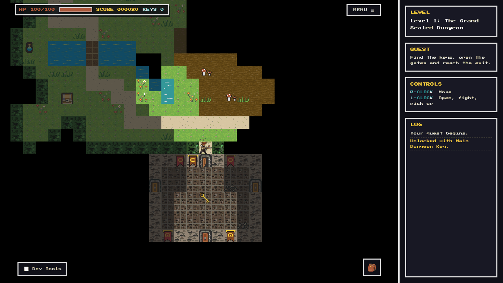
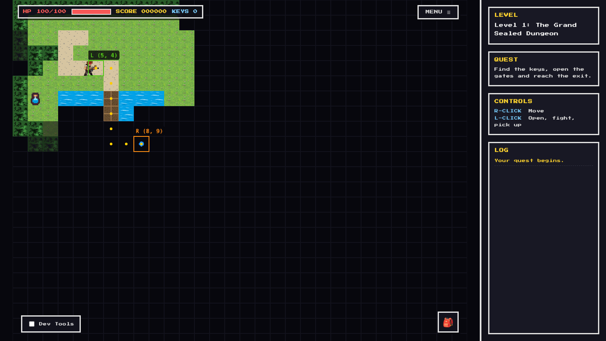

# Web-Based 2D Game Engine Framework

A modular TypeScript framework for browser-based 2D grid games, powered by PixiJS. It provides rendering, multi-layer JSON maps, view handling, A* pathfinding with terrain costs, field of view with shadows and several lights, Fog of War, flood-fill room reveal, mouse-to-cell input, particles, animation helpers and a small editor toolkit. Game-specific rules stay in your application.



## Where to Get It

- **GitHub Packages:** `@doz6x9/web-based-2d-game-engine-framework` (see [Install](#install) for the one-time `.npmrc` setup)
- **Engine source only:** the [`engineFramework`](https://github.com/doz6x9/web-based-2d-game-engine-framework/tree/engineFramework) branch. Clone it to work on the engine itself.
- **Engine plus a playable demo game:** the [`main`](https://github.com/doz6x9/web-based-2d-game-engine-framework) branch, where the engine lives in `packages/engine` and the demo in `apps/demo`.

## Features

- PixiJS 8 renderer with layered tile maps, camera control, sprite containers, particles, markers, and fog overlays.
- Grid primitives, vectors, tile definitions, map parsing, and generic entity contracts.
- A* pathfinding with terrain costs, raycast/shadowcast field of view, fog of war, and flood fill utilities.
- Event-driven engine lifecycle with typed events for map loading, input, update, and render hooks.
- ESM and CommonJS package output with TypeScript declaration files.
- Unit tests (Vitest) for the algorithms, shadowcasting, lighting, fog, map layers and mouse input.

## Screenshots

From the demo game on the `main` branch.

| | |
|---|---|
|  |  |
| A\* path to a right-clicked cell, with left and right clicks labelled by grid cell. | Several torches at once. Walls cast shadows, and unexplored cells stay dark. |

## Install

The package is published to GitHub Packages as `@doz6x9/web-based-2d-game-engine-framework`.

GitHub Packages needs two lines in an `.npmrc` file in your project, even for public packages. The token is a GitHub personal access token (classic) with the `read:packages` scope.

```ini
@doz6x9:registry=https://npm.pkg.github.com
//npm.pkg.github.com/:_authToken=YOUR_GITHUB_TOKEN
```

Then install it with PixiJS:

```bash
npm install @doz6x9/web-based-2d-game-engine-framework@^0.3.0 pixi.js
```

PixiJS is a peer dependency so host applications can control their renderer version.

### What's new in 0.3.0

- Symmetric recursive shadowcasting over all eight octants (`fov.calculateFOV(source, radius, 'shadowcast')`), and no light through diagonal wall gaps in either algorithm.
- Map layers have roles (ground, collision, overlay). Name them in the map, on the layer, or with the `layerNames` engine option; overlay layers such as decor draw between the ground and entities.
- `TileRegistry` is the single source of tile walkability and cost.
- 61 unit tests.

## Quick Start

```ts
import { GameEngine, Vector, type AssetConfig, type IEntity } from '@doz6x9/web-based-2d-game-engine-framework';

const canvas = document.querySelector<HTMLCanvasElement>('#game')!;
const engine = new GameEngine();

const assets: AssetConfig[] = [
  { id: 'grass', path: '/assets/grass.png' },
  { id: 'hero', path: '/assets/hero.png' },
];

await engine.initWithOptions({
  canvas,
  width: 1280,
  height: 720,
  assets,
  initialMapUrl: '/maps/level-1.json',
});

class Player implements IEntity {
  id = 'player';
  position = new Vector(2, 2);
  spriteName = 'hero';
  isActive = true;

  update(deltaTime: number): void {
    // Put game-specific movement, combat, or interaction logic here.
  }
}

engine.on('mapLoaded', () => {
  engine.addEntity(new Player());
});

engine.on('gridClick', (x, y, button) => {
  if (button !== 'right') return;

  const player = engine.getEntity('player');
  if (!player) return;

  const path = engine.pathfinder.findPath(player.position, new Vector(x, y));
  console.log(path);
});
```

## Public API

Import from the package root:

```ts
import {
  GameEngine,
  Renderer,
  Grid,
  Vector,
  TileRegistry,
  AStarPathfinder,
  FieldOfView,
  FogOfWar,
  FloodFill,
  LightingSystem,
  ParticleSystem,
  AnimationLibrary,
  LevelEditor,
} from '@doz6x9/web-based-2d-game-engine-framework';
```

The root export intentionally exposes engine building blocks instead of forcing one game architecture. Use `GameEngine` for an integrated runtime, or compose lower-level modules directly for custom tools, simulations, editors, and tests.

## Sprite Sheets

Assets can be single images or a PixiJS spritesheet (texture atlas). Every frame in a sheet is registered under its frame name, so maps and entities use frame names exactly like image ids.

```ts
const assets: AssetConfig[] = [
  { id: 'atlas', path: '/atlas/sprites.json', type: 'spritesheet' },
];
```

One atlas means one request and one GPU texture, which lets PixiJS batch tiles and sprites instead of switching textures. `renderer.loadSpritesheet(path)` loads a sheet at runtime and returns its frame names.

## Fitting the View to the Map

Maps can be smaller or larger than the canvas. As each map loads, the engine:

- picks the largest whole-number zoom that still shows the whole map (`fitMapToView`, on by default), so small maps fill the screen and stay pixel-crisp;
- centres a map that is still smaller than the view, and scrolls with `camera.centerOn()` when it is larger;
- with `fitCanvasToMap: true`, shrinks the canvas to the map so there are no empty borders. Listen for the `viewResized` event to resize your page layout.

```ts
await engine.initWithOptions({ canvas, width: 1280, height: 720, assets, fitCanvasToMap: true });
engine.on('viewResized', (w, h) => console.log('canvas is now', w, h));
```

`renderer.fogStyle` sets the Fog of War colours. Unexplored cells are black by default. Giving `unknownGridColor` a colour draws a faint grid over them so they read as "not explored yet" rather than empty space.

## Lighting

`engine.lighting` combines any number of light sources into one visible set and feeds it to Fog of War every frame. It only recalculates when a light is added, removed, moved, resized or toggled.

```ts
const playerPos = new Vector(2, 2);
engine.lighting.addLight({ id: 'player', position: playerPos, radius: 10 });
engine.lighting.addLight({ id: 'torch-1', position: new Vector(20, 18), radius: 3 });

playerPos.x += 1;                           // lights follow the Vector you pass in
engine.lighting.setEnabled('torch-1', false);
engine.lighting.markDirty();                // call after changing walls or doors on the grid

// Torches in undiscovered rooms stay dark until their cell is explored:
engine.lighting.addLight({ id: 'torch-2', position: new Vector(8, 4), radius: 4, hiddenUntilExplored: true });
```

Lights are cleared by `engine.clear()`. If no lights are registered, the engine leaves Fog of War alone so you can drive `engine.fov` yourself.

## Spawn Points, Rooms and Click Coordinates

- `engine.getSpawnPoint()` returns the map's `PLAYER_SPAWN` object. If that cell isn't walkable, or the map has no spawn, it returns the nearest walkable cell instead.
- `engine.revealRoom(cell)` uses flood fill to mark every cell reachable from `cell`, plus the walls around them, as explored. Call it with the cell just past a door when the door opens, while the door cell is still solid, so the fill stays inside that room.
- `initWithOptions({ ..., showMouseCoordinates: true })` draws the clicked cell's coordinates on the canvas: green for left clicks, orange for right clicks.
- Fog of War draws unexplored cells fully black and explored cells that aren't currently lit as greyed out.
- `AStarPathfinder` scales its heuristic by the cheapest walkable cell cost, so it still returns the cheapest path when roads cost less than 1.
- The engine grid is resized to each map as it loads, so nothing runs past the map edge.

## Map Format

Maps are JSON objects with named layers, drawn bottom-up in file order. Each layer has a role:

- **ground**: tile types for every cell (tile 0 is a real tile here).
- **collision** (optional): a non-zero value overrides the ground tile for walkability and cost. It is not drawn.
- **overlay**: everything else, such as decor. Drawn on top of the ground, 0 means empty, and it never affects movement.

A layer can set its own `"role"`, or the map can name them with `"groundLayer"` and `"collisionLayer"`. Otherwise the engine uses the `layerNames` option (`new GameEngine({ layerNames: { ground: 'floor', collision: 'walls' } })`), then the defaults `terrain` and `collision`, and finally the first layer as ground.

```json
{
  "name": "Level 1",
  "width": 40,
  "height": 30,
  "layers": [
    { "name": "terrain", "data": [[0, 0, 0], [0, 4, 0]] },
    { "name": "landmarks", "data": [[0, 0, 20], [0, 0, 0]] },
    { "name": "collision", "data": [[0, 1, 0], [0, 0, 0]] }
  ],
  "objects": [
    { "type": "PLAYER_SPAWN", "x": 5, "y": 5 }
  ]
}
```

`MapLoader` also accepts flat one-dimensional layer data, which is useful for maps exported from tile editors.

Tile ids, costs, walkability and sprites all come from `TileRegistry`. Register your own tiles, such as decor for an overlay layer, before loading a map:

```ts
TileRegistry.registerTile(20, { sprite: 'flowers', name: 'Flowers', walkable: true, cost: 1, color: 0xd6404a });
```

## Engine Events

| Event | Callback |
| --- | --- |
| `mapLoaded` | `(mapData)` |
| `viewResized` | `(width, height)` |
| `gridClick` | `(x, y, button)` |
| `gridHover` | `(x, y)` |
| `update` | `(deltaTime)` |
| `beforeRender` | `()` |
| `afterRender` | `(renderer)` |

## Local Development

You need Node.js 20.19 or newer.

On the `engineFramework` branch, the engine is at the top of the repository:

```bash
npm install
npm run build          # builds the npm package into dist/
npm test               # runs the unit tests
```

On `main` or `develop`, the engine is in `packages/engine` and the demo in `apps/demo`. From the repository root, `npm run dev` builds the engine and starts the demo, and `npm test` runs the engine tests.

Useful scripts:

- `npm run build` builds the npm package into `dist/`.
- `npm run typecheck` runs TypeScript without emitting files.
- `npm test` runs the unit tests once; `npm run test:watch` re-runs them on save.
- `npm pack --dry-run` verifies the exact package contents before publishing.

## Running the Tests

The engine has 61 unit tests (Vitest) for A* pathfinding (including terrain costs and shortest-path checks), field of view and shadows, symmetric shadowcasting (all octants, doorways, no leaks through diagonal wall gaps), map layer roles, tile costs, several lights at once, Fog of War, flood fill room reveal, and turning mouse clicks into grid cells.

```bash
npm test            # run once
npm run test:watch  # re-run on save
```

## Publish Checklist

1. Update `name`, `version`, `author`, `repository`, and `keywords` in `package.json`.
2. Run `npm run build`.
3. Run `npm pack --dry-run` and check that only package files are included.
4. Log in to GitHub Packages with a GitHub token that has the `write:packages` scope: `npm login --scope=@doz6x9 --auth-type=legacy --registry=https://npm.pkg.github.com` (use your GitHub username, and the token as the password).
5. Publish with `npm publish`. `publishConfig` in `package.json` sends it to GitHub Packages.
6. To publish to npmjs.com as well, run `npm login` and then `npm publish --registry=https://registry.npmjs.org --access public`. This needs an npmjs account named `doz6x9` (or an npm organisation with that name) to own the `@doz6x9` scope.

## License

MIT
