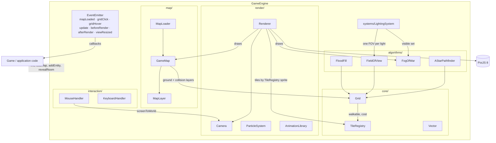
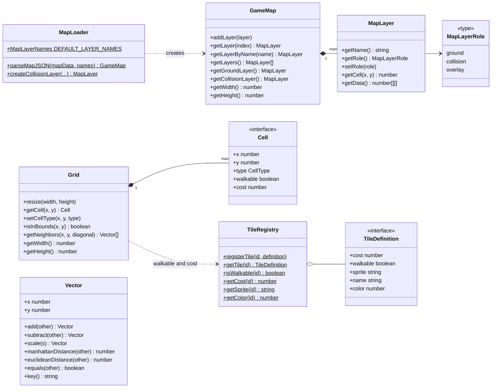
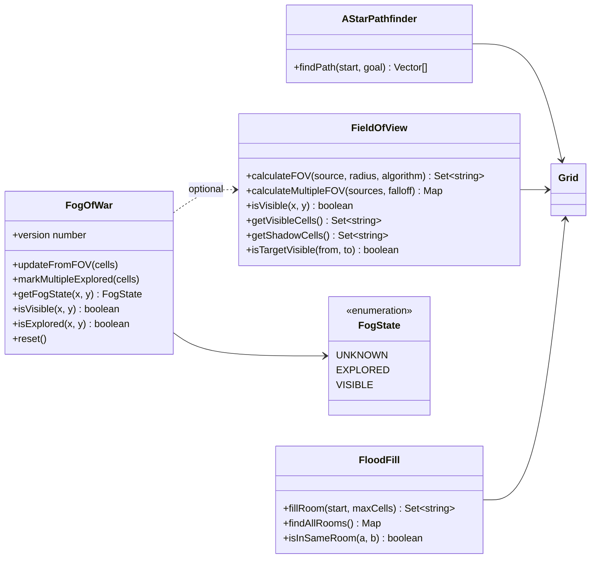
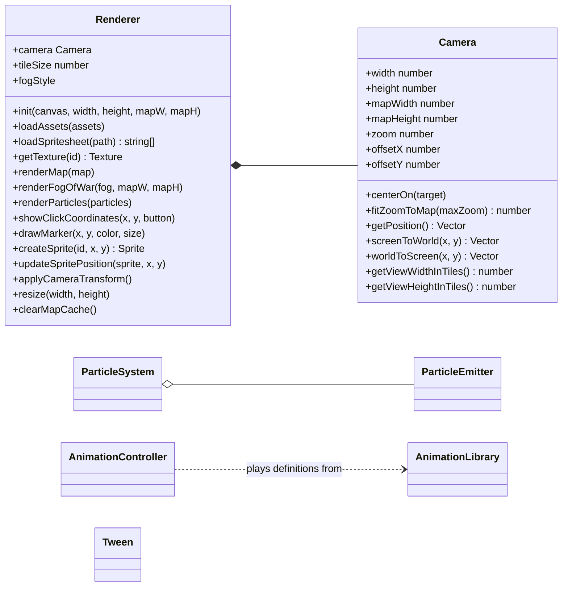
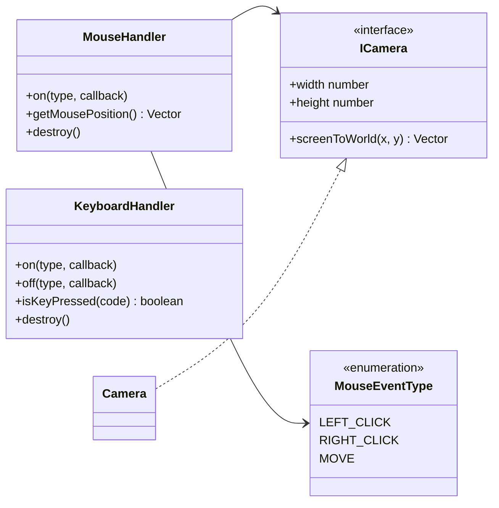
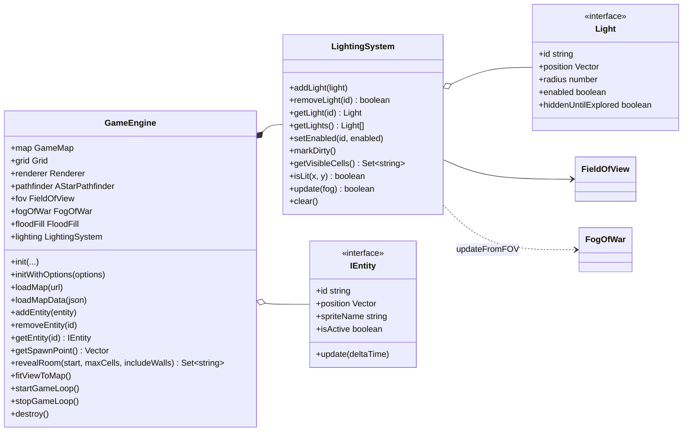
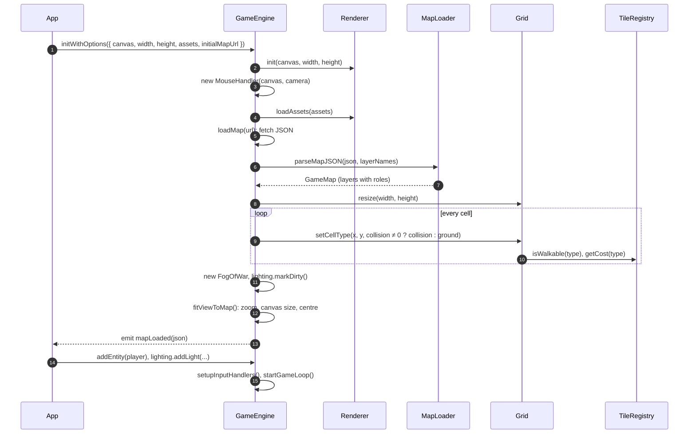
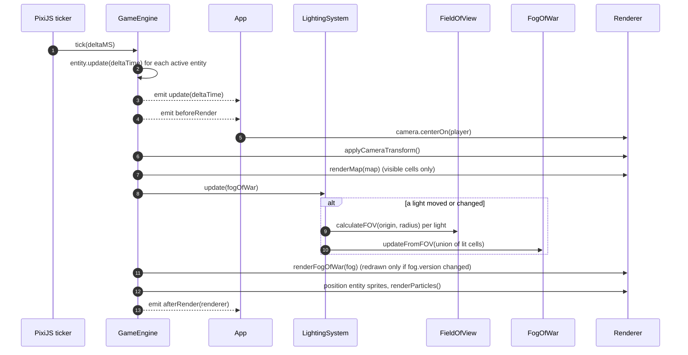
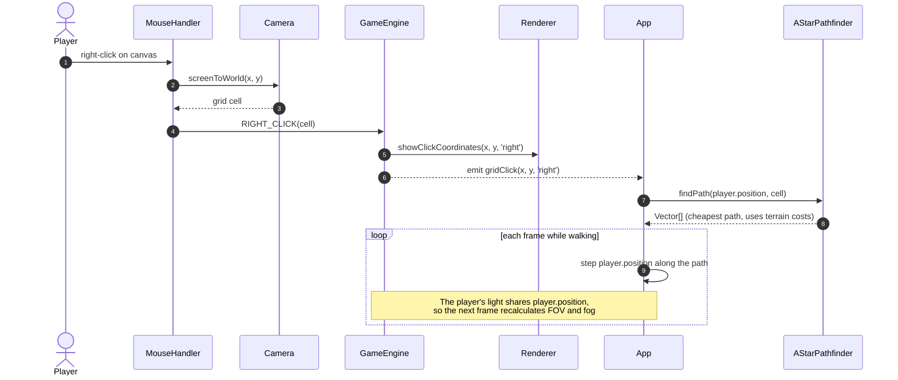
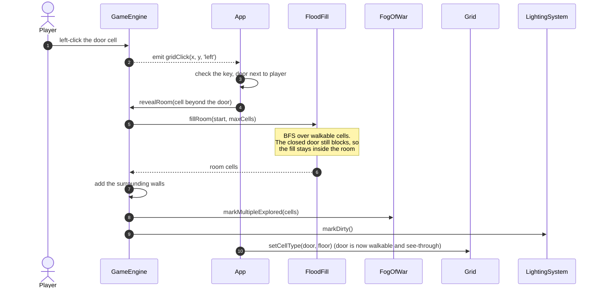

# Engine Architecture

These diagrams are drawn from the engine's TypeScript source (`src/`). They show the public API only; private helpers are left out. GitHub renders the Mermaid blocks as diagrams.

- [Module overview](#module-overview)
- [Class diagrams](#class-diagrams): [core and map](#core-and-map), [algorithms](#algorithms), [rendering](#rendering), [interaction](#interaction), [lighting](#lighting)
- [Sequence diagrams](#sequence-diagrams): [startup and map loading](#startup-and-map-loading), [one frame](#one-frame), [click to move](#click-to-move-a-and-field-of-view), [opening a door](#opening-a-door-flood-fill-room-reveal)

## Module overview

`GameEngine` owns one instance of each subsystem and wires them together. Game rules (combat, keys, items) live in the application, which talks to the engine through its public fields and events.

## Class diagrams

### Core and map

A map file is parsed into a `GameMap` of `MapLayer`s. Each layer has a role: the ground and collision layers fill the `Grid`, overlay layers are only drawn. Every cell's walkability and cost come from `TileRegistry`.

### Algorithms

All four algorithms read the same `Grid`, so a change to a cell (a door opening) is seen by pathfinding, sight and flood fill at once. Cells are passed around as `"x,y"` string keys.

`calculateFOV` takes `'raycast'` (rays to the edge of the radius) or `'shadowcast'` (recursive symmetric shadowcasting over eight octants). Both stop light passing between two walls that touch diagonally.

### Rendering

Draw order inside the world container, bottom to top: one container per non-collision map layer (ground first, then overlays in file order), entity sprites, particles, fog, field-of-view debug, markers, click labels.

### Interaction

### Lighting

A light's `position` is read every frame, so a light shares the player's `Vector` to follow it. Lighting only recalculates when a light moved, changed or was toggled, or after `markDirty()`.

## Sequence diagrams

### Startup and map loading

### One frame

### Click to move (A\*) and field of view

### Opening a door (flood-fill room reveal)

